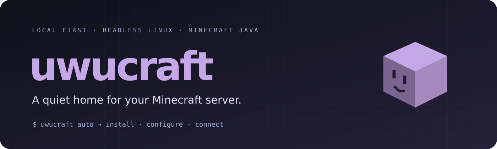
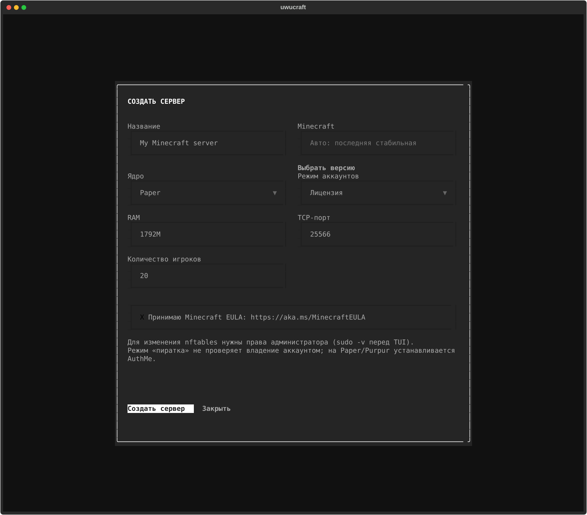
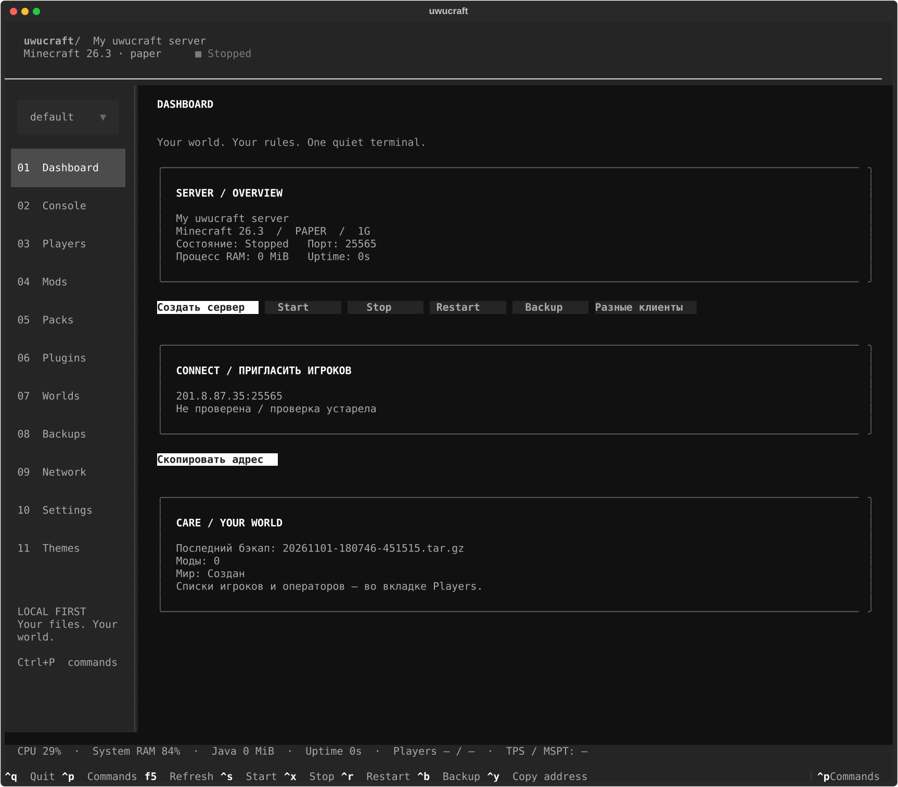

<div align="center">



[](https://github.com/futureUnd1ground/uwucraft/actions/workflows/ci.yml)

[](LICENSE)

**Minecraft Java на своём компьютере с Linux или Windows. Создание и управление из терминала.**

</div>

## Установка

### Windows 10/11 (x64)

Скачайте [архив Windows из Releases](https://github.com/futureUnd1ground/uwucraft/releases/latest), распакуйте в постоянную папку и запустите **`install.cmd`** двойным щелчком. Установщик создаст отдельное Python-окружение, добавит команду `uwucraft` в пользовательский PATH и ярлык на рабочий стол. В Windows ZIP уже включён официальный установщик Python 3.14.10 x64. Если подходящего Python нет, `install.cmd` проверит SHA-256 и подпись Python Software Foundation, затем установит Python в пользовательский каталог приложения. `winget` и ручная установка Python не нужны. При запуске из обычного Git checkout установщик скачает тот же файл с python.org. Для Python-пакетов, Java и Minecraft всё ещё нужен интернет.

Из PowerShell в каталоге репозитория:

```powershell
powershell.exe -NoProfile -ExecutionPolicy Bypass -File .\install.ps1
# Откройте новый терминал после установки:
uwucraft
uwucraft create --quick --loader paper --port 25565 --accept-eula --start
```

`Bypass` действует только для этого процесса, постоянная политика PowerShell не меняется. WSL, Docker и отдельная системная Java не нужны: совместимый Temurin скачивается автоматически с SHA-256. Команда `uwucraft` и мастер одинаковы на обеих ОС. В режиме `direct` при первом добавлении правила Defender Windows покажет UAC: подтвердите действие. Отмена даст конкретную ошибку, не ложное подтверждение доступности.

**Автозапуск Windows — после входа владельца в систему**, через пользовательскую задачу Планировщика заданий. Пароль Windows не запрашивается и не сохраняется. Это не служба до входа и не гарантия работы после выхода из аккаунта; не выходите из системы, если сервер должен продолжать работать. Заблокировать экран можно. Спящий режим/выключение ПК прерывают сервер. Watchdog перезапускает JVM после падения, но обычный `uwucraft stop` оставляет её остановленной. После пяти падений за пять минут проверьте журнал; старт задачи Планировщиком имеет собственный ограниченный retry.

Некоторые сборки Java Windows не запускаются из Unicode-пути при отключённых коротких именах 8.3. В таком случае приложение выдаст конкретную ошибку: задайте `$env:XDG_DATA_HOME = "C:\uwucraft-data"` в доступном вам ASCII-каталоге и повторите создание. Кириллица в настройках и каталоге сервера проверяется отдельно.

Данные: `%LOCALAPPDATA%\uwucraft`, настройки: `%APPDATA%\uwucraft`, приложение: `%LOCALAPPDATA%\uwucraft-app`. Консоль — локальный named pipe с отдельным случайным ключом, без RCON и сетевого порта управления. Сохраняйте ACL личных каталогов Windows; POSIX `chmod` на Windows не обеспечивает приватность. `uwucraft service` регистрирует автозапуск, `uwucraft backup-schedule` — ежедневную копию в 04:00 (пользователь должен быть в системе). `XDG_CONFIG_HOME`/`XDG_DATA_HOME` при необходимости переопределяют пути и на Windows; имена задач изолированы по каталогу данных.

Для удаления автозапуска используйте «Планировщик заданий»: задачи `uwucraft-server-*`, `uwucraft-network-*`, `uwucraft-backup-*`. Правило Defender: `uwucraft-TCP-ПОРТ`. Удаление приложения не должно удалять мир: сначала выполните `uwucraft stop`, сохраните backup, затем удалите только `%LOCALAPPDATA%\uwucraft-app` и ярлык.

### Linux

Arch Linux / CachyOS, Python 3.11.8+, systemd:

```bash
sudo pacman -S --needed python uv iproute2 wl-clipboard
git clone https://github.com/futureUnd1ground/uwucraft.git
cd uwucraft
./install.sh
uwucraft
```

Обычное управление не требует root. `wl-clipboard` нужен только для буфера Wayland; по SSH возможен OSC 52, если терминал его разрешает. Сервер работает headless, независимо от Niri и графической сессии.

## Публичный доступ за CGNAT и через VPN

При прямом доступе нужен публичный IPv4 и входящий TCP-порт. IP выхода VPN не является адресом домашнего сервера. Приложение показывает и копирует приглашение только после независимой проверки Minecraft с совпадением идентификатора вашего сервера; устаревшие результаты и остановленный relay не дают ложного подтверждения.

**Новые серверы в CLI и TUI по умолчанию используют TCP relay bore.pub** — в том числе за CGNAT и при активном VPN. Для существующего сервера режим можно включить явно:

```bash
uwucraft network relay
uwucraft copy-address
# отключение:
uwucraft network relay --stop
```

В TUI: Network → «Включить TCP relay». Minecraft и мир остаются на вашем ПК; игрокам достаточно обычного адреса `IPv4:порт`, без регистрации или установки VPN. Официальный клиент bore скачивается с GitHub с проверкой SHA-256. Linux использует отдельный systemd user service, Windows — задачу Планировщика после входа пользователя. Relay переподключается после разрыва и повторяет внешнюю проверку каждые 3 минуты. При переподключении публичный порт может измениться: берите актуальный адрес из приложения. Бесплатный публичный bore.pub не гарантирует доступность или постоянный адрес; трафик проходит через сторонний сервер. Создание не требует настройки входящего firewall или проброса на роутере. Для прямого доступа используйте `uwucraft create --public-access direct` либо `uwucraft network configure --public-access direct` у существующего сервера. Существующие профили автоматически не переключаются.

`online-mode=false` допускает подмену ника: whitelist не заменяет авторизацию. Для общедоступного сервера используйте официальный вход либо совместимый с ядром мод/плагин авторизации.

## Несколько серверов и версии Minecraft

CLI и TUI на **Windows и Linux** используют одну коллекцию профилей. Старый сервер остаётся в `default`: его мир не перемещается. Новый сервер — отдельный профиль со своей Java, версией Minecraft, ядром, RAM, портом, миром, AuthMe, backups и консолью. Создание не обновляет и не понижает версию старого мира.

```powershell
uwucraft versions --loader paper --limit 30
uwucraft versions --loader forge --limit 50
uwucraft --profile survival create --quick --loader paper --version 1.21.4 --memory 2G --port 25566 --accept-eula --start
uwucraft --profile mods create --quick --loader forge --version 1.20.1 --memory 4G --port 25567 --accept-eula --start
uwucraft profile list
uwucraft --profile survival stop
uwucraft profile use mods
uwucraft status
```

`--profile`/`-p` ставится **перед командой**, ID: до 40 строчных латинских букв, цифры, `_`, `-`. Отображаемое название сервера может быть русским. Без флага используется профиль из `profile use`; флаг действует только на текущий запуск. Новый ID создаётся при успешной установке, без отдельного вопроса в мастере. Список опубликованных версий берётся из официальных API; наличие стабильного build выбранного ядра проверяется при установке. `versions --loader vanilla --snapshots` включает snapshots явно. Самая новая версия не подставляется вместо несовместимой запрошенной версии.

В TUI есть переключатель профиля в боковой панели. **«Создать сервер»** при установленном текущем сервере открывает новый профиль; кнопка **«Выбрать версию»** прямо под полем Minecraft показывает каталог выбранного ядра с фильтром. Порт по умолчанию выбирается свободный и не закреплённый за другим профилем. Одновременно можно запускать несколько серверов при разных TCP-портах и достаточной RAM. Ограничения публичного IPv4/маршрутизатора остаются теми же.

Новые каталоги: `uwucraft/profiles/ID` внутри пользовательских корней config/data. На Linux службы — `uwucraft-server@ID.service`, `uwucraft-network@ID.service`, backup timers — `uwucraft-backup@ID.timer`. Службы `default` сохраняют прежние имена. Перед сохранением выбора программа фиксирует старые units на `default`, без перезапуска Java. На Windows задачи и named pipes изолированы по каталогу профиля. Восстановление backup профиля `default` не заменяет настройки других профилей и текущий выбор.

## Разные версии клиентов на одном сервере

На современном **Paper/Purpur с Java 17+** нажмите **«Разные клиенты»** в TUI либо выполните:

```powershell
uwucraft --profile survival compat-setup --restart
# Дополнительно ViaRewind для старых протоколов 1.7/1.8:
uwucraft --profile survival compat-setup --restart --legacy-clients
```

Будет сохранён мир, создан backup и установлены официальные ViaVersion + ViaBackwards; `--legacy-clients` добавляет ViaRewind. GitHub-релизы проверяются по SHA-256, все JAR загружаются до замены существующих, при ошибке замены сохраняются прежние плагины. Если сервер работал, `--restart` разрешает временно отключить игроков и запустить его снова. Без флага остановите сервер сами. Это перевод протоколов, **не изменение версии мира**.

ViaVersion обслуживает более новые клиенты, ViaBackwards — более старые (в пределах поддержки конкретных релизов), ViaRewind — дополнительные старые протоколы. Точный диапазон и ограничения сверяйте с [официальной таблицей ViaVersion](https://github.com/ViaVersion/ViaVersion#supported-versions) и логом плагинов. Блоки/механики новых версий могут заменяться для старых клиентов; версии Forge/Fabric и наборы модов должны совпадать отдельно. Это не поддержка Bedrock. Старые ядра с Java 8 не переключаются принудительно на Java 17 ради плагинов — создайте отдельный совместимый профиль. Полный игровой вход со всех клиентских версий автоматически не проверяется.

## Создать сервер

В TUI нажмите **«Создать сервер»** либо выполните:

```bash
uwucraft create
```

Мастер запрашивает только название, Minecraft, ядро, режим аккаунтов, RAM, TCP-порт и количество игроков. Пустая версия/`auto` означает последнюю стабильную совместимую версию из официального API; RAM предлагается по доступной памяти с резервом системе. Стандартный порт — `25565`. Последний шаг — явное принятие [Minecraft EULA](https://aka.ms/MinecraftEULA).



После EULA нет дополнительных вопросов о конфигурации. Общий backend для CLI и TUI:

1. Проверяет RAM, свободное место и занятость порта; для режима `direct` при необходимости устанавливает `iproute2` на Arch.
2. Находит совместимую Java или устанавливает проверенный по SHA-256 Eclipse Temurin в пользовательский каталог.
3. Скачивает выбранное ядро из официального источника, проверяет предоставленные хеши.
4. Создаёт TOML и `server.properties`: `server-ip=0.0.0.0`, выбранные порт, режим и число игроков. RCON выключен.
5. Настраивает JVM, user unit `uwucraft.service` и linger на Linux либо пользовательскую задачу Планировщика Windows; включает restart после падения. Создаёт первую резервную копию.
6. Запускает Minecraft и ожидает подтверждения готовности в логе.
7. По умолчанию устанавливает официальный bore с SHA-256 и включает отдельный автозапуск TCP relay.
8. Получает публичный адрес relay и независимо проверяет Minecraft и уникальный идентификатор сервера.
9. При явном `--public-access direct` вместо relay настраивает nftables/Defender, пробует UPnP/NAT-PMP с продлением, определяет внешний IPv4 через HTTPS и проверяет прямой вход.
10. Показывает публичный адрес и большую кнопку **«Скопировать адрес»**, а также результат проверки и конкретные ошибки.

В реализации запуск/проверка сервера предшествуют настройке сети: внешний probe выполняется только после подтверждённого запуска. В режиме `direct` ошибка настройки firewall не мешает попытке проброса и внешней проверки; в отчёте сохраняются все обнаруженные проблемы.

### Без вопросов

```bash
uwucraft create --quick --loader paper --port 25565 --accept-eula --start

uwucraft create --quick --name "Friends" --loader fabric --version 1.21.1 \
  --memory 4G --port 25566 --max-players 12 --mode license --accept-eula --start

uwucraft create --quick --name "Friends" --loader paper --mode pirate \
  --memory 4G --max-players 12 --accept-eula --start
```

`--quick` никогда не запрашивает интерактивный ввод. Без `--accept-eula` создание отклоняется **до любых изменений**. Режим: `license`/`лицензия` → `online-mode=true`, `pirate`/`пиратка` → `false`. `--dry-run` показывает параметры без установки и сетевых изменений; `--no-start` подготавливает сервер, но внешняя доступность останется неподтверждённой.

`auto` и `install` оставлены короткими входами в этот же мастер. Сетевые настройки прежнего релиза больше не используются; устаревший дополнительный сетевой сервис при миграции отключается. Миры и существующие свойства не удаляются.

### Права администратора

На Windows права для Defender подтверждаются через системный UAC. Следующий раздел о sudo относится к Linux.

Программа не может обойти права ОС. Для изменения nftables и установки системных зависимостей нужна авторизация sudo. Чтобы мастер не задавал пароль в середине операции, в **том же терминале**, из которого запускается программа, предварительно выполните:

```bash
sudo -v
uwucraft create --quick --loader paper --port 25565 --accept-eula --start
```

Либо `sudo -v`, затем `uwucraft` для TUI. Само приложение не нужно запускать от root. Backend использует `sudo -n`: если прав нет, он возвращает конкретную ошибку, продолжает доступные непривилегированные шаги и не объявляет настройку успешно завершённой. Root-owned firewall helper не импортирует пользовательский Python-пакет; systemd не исполняет изменяемый пользователем код от root после установки helper.

При отказе в linger будет показана отдельная команда: `sudo loginctl enable-linger "$USER"`. На системах без systemd создание завершается понятной ошибкой.

### Существующий сервер

Каждый профиль содержит один сервер. `create` никогда не перезаписывает существующий сервер профиля, EULA, настройки или мир. Для повторной автоматической настройки сети уже установленного сервера:

```bash
sudo -v
uwucraft network configure
```

Для второго сервера используйте `uwucraft --profile ИМЯ create`. Профили изолируют файлы и службы в пределах одного аккаунта на обеих ОС. XDG-переменные меняют корень коллекции профилей. Не устанавливайте новый сервер поверх каталога существующего мира.

## Прямой публичный IPv4

На экране подключения показывается только:

```text
ПУБЛИЧНЫЙ_IP:ПОРТ
```

Адрес должен быть глобальным IPv4. Частные, loopback, CGNAT, документационные, multicast-адреса и IPv6 отбрасываются. Успешный TCP listen на компьютере **не** является внешней проверкой.

```bash
uwucraft network configure       # nftables + UPnP/NAT-PMP + внешний probe
uwucraft network address         # только публичный IPv4:порт и статус
uwucraft network check           # независимая внешняя проверка
uwucraft network probe ПУБЛИЧНЫЙ_IP:25565
uwucraft copy-address
```

Внешняя проверка использует [официальный API mcsrvstat.us](https://api.mcsrvstat.us/): он получает адрес сервера и может кэшировать результат до пяти минут. Для новой установки в MOTD помещается случайный идентификатор: одного `online=true` недостаточно — должен отвечать именно созданный сервер. Состояние проверки устаревает; неизвестное состояние не показывается как «доступен».

### Что нельзя исправить только на ПК

| Ошибка | Что исправить |
|---|---|
| WAN маршрутизатора в `100.64.0.0/10` | CGNAT: запросить у провайдера публичный белый IPv4 с входящими TCP-соединениями. |
| WAN не публичный | Устранить дополнительный NAT или заказать белый IPv4. |
| UPnP/NAT-PMP не отвечают | Включить поддерживаемый протокол на роутере либо вручную пробросить выбранный TCP-порт на этот компьютер и закрепить его адрес в DHCP. |
| Порт уже назначен другому устройству | Освободить правило или выбрать другой порт. Чужое UPnP-правило не перезаписывается. |
| WAN и HTTPS IPv4 различаются | Проверить двойной NAT и корректность маршрута ответных пакетов. |
| Отказ UAC/политика Defender | Подтвердить UAC и повторить `network configure`; при доменной политике обратиться к администратору Windows. |
| Нет прав на nftables | Выполнить `sudo -v` в терминале запуска и повторить `network configure`. |
| Внешний порт не отвечает | Проверить входящие подключения у провайдера, проброс, firewall и маршрут. Повторить probe после истечения кэша. |
| Внешняя проверка недоступна | Проверить доступ к API; до положительного результата доступность неизвестна. |

CGNAT определяется, **если маршрутизатор сообщил WAN**. Если оба протокола отключены и WAN недоступен, публичный HTTPS-адрес сам по себе не доказывает отсутствие CGNAT. Программа сообщает, что автопроброс не выполнен и причину нужно уточнить в настройках роутера/у провайдера; не выдумывает диагноз. При известном WAN можно проверить его отдельно:

```bash
uwucraft network diagnose --wan-ip WAN_IPV4
```

UPnP control URL берётся из описания IGD, а не угадывается; принимаются только URL самого шлюза, без redirects/proxy. NAT-PMP использует RFC 6886 и подключённый UDP-сокет, принимающий ответы от указанного шлюза. При неподдерживаемом автопробросе успешная внешняя проверка может подтвердить уже существующее ручное правило; тогда ограничение автоматической настройки показывается примечанием.

### nftables и загрузка

Разрешение добавляется в начало **каждой** действующей IPv4 input base chain (`ip`/`inet`). Отдельная accept-chain не решает проблему последующего drop в другой цепочке. Для `inet` исключение ограничено IPv4; затрагивается только выбранный TCP-порт. Не применяются `flush ruleset`, изменение policy, отключение firewall или DMZ.

Правила отмечаются комментарием `uwucraft-tcp-PORT`. Повторная настройка не накапливает дубликаты. Root helper `/etc/uwucraft/firewall-PORT.py` и `uwucraft-firewall-PORT.service` восстанавливают исключения после старта nftables/firewalld. Если сторонний менеджер позже полностью перезагрузит ruleset, повторите `network configure`. Неизвестные правила ingress/prerouting и ограничения провайдера могут по-прежнему блокировать вход: решающей остаётся внешняя проверка.

## Режим аккаунтов

`license` — стандартная проверка владения аккаунтом. `pirate` отключает её, поэтому имя можно подделать. На Paper/Purpur автоматически устанавливается AuthMe; аккаунты регистрируются в Minecraft. Для Vanilla/Fabric/Forge/NeoForge встроенной дополнительной авторизации нет: не выдавайте op неподтверждённым именам, установите совместимый auth-мод при необходимости.

Новая публичная установка не включает whitelist и не создаёт операторов автоматически, поэтому ник администратора не запрашивается. Управляйте списками после создания:

```bash
uwucraft whitelist add PlayerName
uwucraft whitelist on
uwucraft ops add PlayerName
uwucraft ops remove PlayerName
```

Существующие whitelist/ops и AuthMe DB сохраняются. Неподтверждённый ник не следует делать оператором. Для разных клиентских версий смотрите раздел ниже.

## Управление и TUI

```bash
uwucraft                         # TUI
uwucraft tui --theme tokyo-night
uwucraft tui --hide-addresses
uwucraft start
uwucraft stop
uwucraft restart
uwucraft status
uwucraft logs --lines 100
uwucraft logs --follow
uwucraft console                 # /exit закрывает консоль
uwucraft command say "Hello!"
```



Ctrl+P/Ctrl+K — command palette, Ctrl+S — start, Ctrl+X — stop, Ctrl+R — restart, Ctrl+B — backup, Ctrl+Y — копирование публичного адреса, F5 — обновление, Ctrl+Q — закрыть TUI. Сервер продолжает работать после закрытия панели. В Console доступны история команд, пауза, поиск и INFO/WARN/ERROR. Долгие операции выполняются вне UI thread.

Темы: UwU Dark, OpenCode Dark, Catppuccin Mocha, Tokyo Night, Gruvbox Dark, Nord, Dracula, Solarized Dark, Solarized Light, Monochrome. Пользовательские темы: [пример](docs/theme-example.toml) → `~/.config/uwucraft/themes/my-theme.toml`. `NO_COLOR` сохраняет бесцветный режим, не перезаписывая выбранную тему в конфигурации.

Буфер Wayland использует `wl-copy`, X11 — доступный `xclip`/`xsel`. OSC 52 не имеет подтверждения от терминала: приложение сообщает об отправке, а не о гарантированном копировании. При отсутствии clipboard адрес остаётся видимым для ручного копирования.

## Контент, настройки, резервные копии

Существующие возможности сохранены:

```bash
uwucraft stop
uwucraft config-set difficulty hard
uwucraft config-set max-players 12
uwucraft mod search lithium
uwucraft mod add lithium
uwucraft mod list
uwucraft mod update
uwucraft mod remove lithium
uwucraft plugin add luckperms
uwucraft datapack add PROJECT_SLUG
uwucraft pack install /path/to/pack.mrpack
uwucraft curseforge add PROJECT_ID --trust-server
uwucraft import-file /path/to/mod.jar --kind mod --trust-file
uwucraft backup
uwucraft list-backups
uwucraft update
uwucraft restore COPY_NAME.tar.gz
uwucraft start
uwucraft backup-schedule --calendar daily
```

Modrinth проверяет версию, loader, server-side и обязательные зависимости. CurseForge требует официальный API key в `secrets.toml` (`0600`) или `CURSEFORGE_API_KEY`; ограничения распространения не обходятся. У неизвестного локального JAR нельзя надёжно доказать совместимость: нужен `--trust-file`. `.mrpack` требует совпадающей версии/loader и чистого назначения. ZIP защищён от traversal/symlinks; распаковка ограничена 8 GiB.

Backup требует остановленного сервера, сохраняет миры, конфигурацию, плагины, AuthMe DB и секреты приватным архивом `0600`. Retention по умолчанию — 7 копий. Restore сначала делает спасательную копию, а выбранный архив защищает от retention. Timer временно останавливает сервер и возвращает прежнее состояние после копирования. `update` обновляет сборку текущей версии; смена Minecraft/автообновление Forge/NeoForge пока не реализованы.

## Каталоги и сервисы

```text
~/.config/uwucraft/config.toml           # имя, версия, ядро, Java, RAM, порт, max_players
~/.config/uwucraft/themes/*.toml
~/.local/share/uwucraft/server/          # миры, properties, JAR, контент, логи
~/.local/share/uwucraft/backups/
~/.local/share/uwucraft/runtimes/        # проверенная Temurin Java
~/.local/share/uwucraft/console.sock     # приватная консоль 0600, RCON выключен
~/.local/share/uwucraft/deployment.json  # отчёт, ошибки и результат проверки
~/.local/share/uwucraft/network-probe.json
~/.local/share/uwucraft/port-mapping.json
~/.config/systemd/user/uwucraft.service
~/.config/systemd/user/uwucraft-network.service
/etc/uwucraft/firewall-PORT.py           # только если активный firewall настроен с root
/etc/systemd/system/uwucraft-firewall-PORT.service
```

Сервер работает от обычного пользователя. Root используется только для ограниченной настройки firewall/системных зависимостей. Полная системная установка сервера под отдельным service-user не реализована.

## Проверки и границы

```bash
uv venv
uv pip install -e '.[dev]'
.venv/bin/ruff check src tests
.venv/bin/ruff format --check src tests
.venv/bin/pytest -q
uv build
```

Тесты проверяют создание из CLI/TUI с одним backend, EULA до side effects, сохранность существующего мира, точные properties, ошибки прав и CGNAT, payload NAT-PMP, discovery/SOAP UPnP, ограничения адресов, идентичность внешнего сервера, архивы и темы. Реальный синтаксис nftables и идемпотентность проверяются в отдельном `unshare -Urn` network namespace: firewall основной машины не меняется. Если namespace/tools недоступны, этот интеграционный тест явно пропускается.

[Подробности проверки](docs/VALIDATION.md). CI проверяет Python 3.11–3.14. Успешные protocol/unit tests не заменяют реальную проверку маршрутизатора, провайдера, reboot и нагрузки. Полные live lifecycle всех шести ядер не проверены. Системные ограничения не обходятся, неподтверждённая доступность не становится «успехом».

Основные модули: `creation.py` (общий сценарий), `create_ui.py` (форма), `deployment.py` (оркестрация сети), `portmap.py` (UPnP/NAT-PMP), `firewall.py` (ограниченный root helper), существующие `server`, `installers`, `sources`, `backups`, `content`, `config`, `cli`, `tui`, `themes`.

Windows-адаптер использует [официальные задачи с Interactive logon](https://learn.microsoft.com/en-us/powershell/module/scheduledtasks/new-scheduledtaskprincipal) и [архивы Temurin](https://adoptium.net/en-GB/installation). Windows CI проверяет PowerShell, регистрацию/удаление задачи, реальный ZIP Java, named pipe, crash/restart/stop JVM и установщик. JVM fixture проверяет supervisor, не игровой клиент Minecraft и не публичную сеть. UAC на интерактивном рабочем столе и reboot/logoff требуют ручной проверки.

Источники: [Mojang manifest](https://piston-meta.mojang.com/mc/game/version_manifest_v2.json), [Paper API](https://docs.papermc.io/misc/downloads-service/), [Fabric Meta](https://github.com/FabricMC/fabric-meta), [Purpur API](https://api.purpurmc.org/v2/purpur), [NeoForge](https://docs.neoforged.net/user/docs/server/), [RFC 6886](https://www.rfc-editor.org/rfc/rfc6886), [UPnP IGD](https://openconnectivity.org/developer/specifications/upnp-resources/upnp/internet-gateway-device-igd-v-2-0/), [nftables chain semantics](https://wiki.nftables.org/wiki-nftables/index.php/Configuring_chains).

Minecraft принадлежит Mojang/Microsoft. uwucraft не аффилирован с Mojang и не распространяет серверные JAR.
