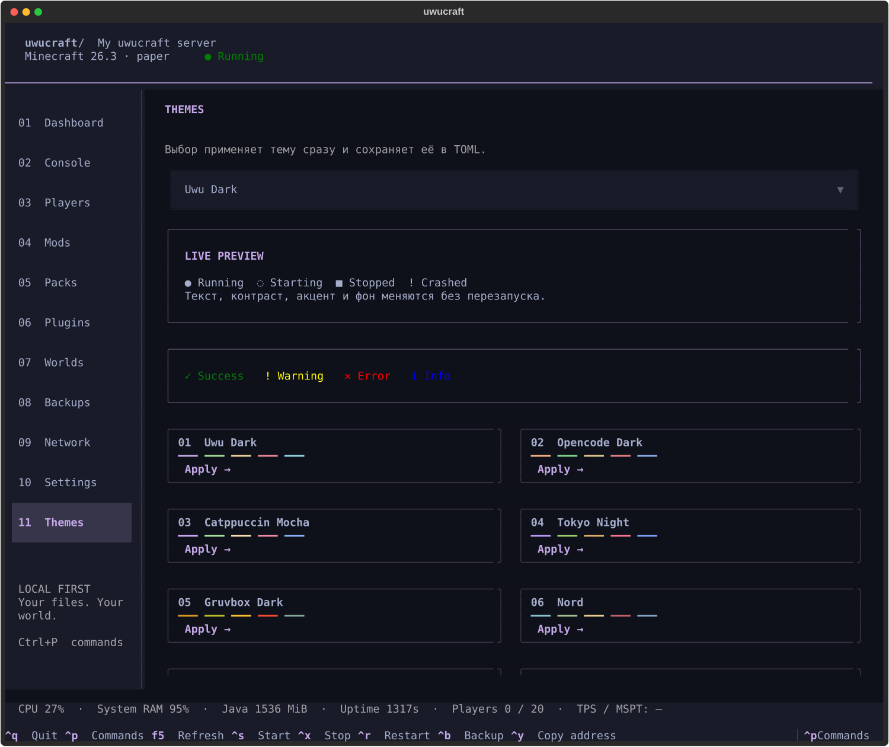
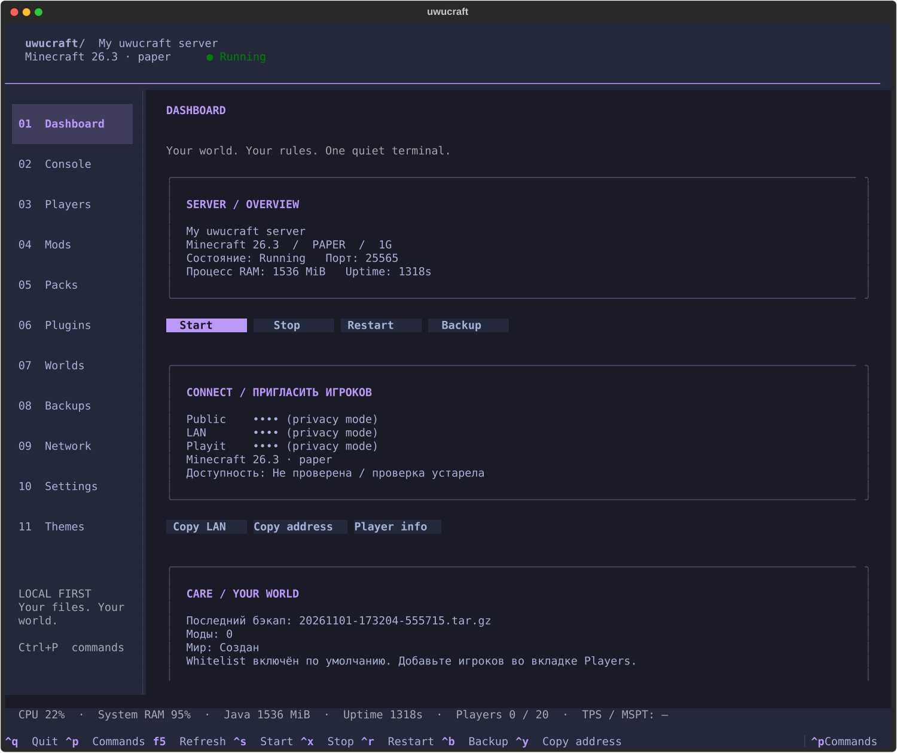

<div align="center">


[](https://github.com/futureUnd1ground/uwucraft/actions/workflows/ci.yml)


[](LICENSE)

**Minecraft на своём ПК. Управление из одного терминала.**

[Быстрый запуск](#быстрый-запуск) · [Неофициальные клиенты](#неофициальные-и-официальные-клиенты) · [Публичный доступ](#публичный-доступ) · [Команды](#команды) · [Проверки и ограничения](#проверки-и-ограничения)

</div>


> Скриншоты экспортированы из реального Textual-приложения с запущенным Paper. Адреса скрыты встроенным `--hide-addresses`. Это ранний рабочий релиз 0.1, а не заявление о завершённом аудите production-безопасности. Список проверенного поведения и ограничений — ниже.

## Что умеет

- Один сервер, один общий Python backend для CLI и TUI. Работа по SSH, без GUI и зависимости от Niri.
- Мастер установки с явным принятием EULA, проверкой порта, RAM и диска, актуальными метаданными официальных источников.
- Vanilla, Paper, Purpur, Fabric и серверные installers Forge / NeoForge. Версия Java определяется по манифесту Mojang; подходящий Temurin можно скачать локально с SHA-256.
- Запуск, корректная остановка, приватная консоль Unix socket `0600`, реальные статусы процесса и живые логи.
- User systemd service `uwucraft.service`: автозапуск, ограниченные повторы после падения, hardening и завершение через `stop`.
- Полные резервные копии остановленного сервера, retention, восстановление конфигурации и мира с предварительной спасательной копией.
- Modrinth: поиск, совместимость с Minecraft/loader, server-side проверка, обязательные зависимости, хеши. CurseForge — с официальным API key и явной проверкой server-side оператором.
- `.mrpack`, datapacks, плагины, явный импорт доверенных локальных JAR/ZIP и HTTPS-файлов.
- 10 тем, TOML-темы, command palette, история консоли, поиск и фильтры логов, асинхронные операции.
- LAN-адрес, clipboard под Wayland/X11, OSC 52 с честным сообщением об отсутствии подтверждения, независимая внешняя проверка Minecraft.
- Опциональные AuthMe, ViaVersion/ViaBackwards и бесплатный TCP relay для CGNAT. Никаких платных подписок, встроенных ключей или аккаунтов автора.

## Быстрый запуск

Arch Linux / CachyOS:

```bash
sudo pacman -S --needed python uv wl-clipboard
git clone https://github.com/futureUnd1ground/uwucraft.git
cd uwucraft
./install.sh
uwucraft auto
```

`~/.local/bin` должен быть в `PATH`. Python 3.11+ обязателен. `wl-clipboard` нужен только для буфера Wayland; по SSH доступен OSC 52, если его разрешает терминал. X11 использует `xclip`/`xsel`, если установлены.

Без аргументов `uwucraft` открывает TUI. Мастер запрашивает ядро, Minecraft, память, порт, режим аккаунтов, администратора и EULA. В неинтерактивном сценарии принятие EULA обязательно задаётся аргументом.

```bash
# Официальные аккаунты, актуальная совместимая версия Paper:
uwucraft auto --loader paper --memory 4G --accept-eula --start --admin YourMinecraftName

# Неофициальные И официальные клиенты, AuthMe, несколько версий клиента:
uwucraft auto --loader paper --memory 4G --accept-eula --start \
  --offline-mode --compatibility --admin YourMinecraftName

# Публичный адрес через опциональный relay, если нет белого IP:
uwucraft auto --loader paper --memory 4G --accept-eula --start \
  --offline-mode --compatibility --admin YourMinecraftName --public-access bore
```

`YourMinecraftName` — имя владельца конкретного сервера. Ни имя автора, ни домашний IP не зашиты в программу.

Java по умолчанию ищется в системе и при отсутствии нужной версии скачивается в каталог данных из Eclipse Adoptium. `--no-local-runtime --install-deps` выбирает установку системной Java через `sudo pacman`. На неподдерживаемой архитектуре программа сообщает об ограничении.

Память выбирается по доступной RAM, а не по общему объёму: минимум 1 GiB оставляется системе. `-Xmx` ограничивает heap, **не весь RSS Java**; библиотеки и native memory требуют дополнительную память. Для небольшого публичного сервера разумно начать с 2–4 GiB heap и свободного резерва; 1 GiB подходит для ограниченного smoke test, а не обещания большой нагрузки.

Повторный `auto` сохраняет миры и настройки. `--start` запускает существующий сервер, `--public-access bore` повторно проверяет публикацию. Новые параметры памяти/ядра не перезаписывают существующую установку: используйте `config-set` или отредактируйте TOML при остановленном сервере.

### Безопасная проба

```bash
uwucraft doctor
uwucraft auto --loader paper --memory 2G --accept-eula --dry-run
```

`--dry-run` не скачивает сервер, не записывает EULA, не открывает порт и не создаёт сервис; для выбора последней версии может обратиться к upstream API.

## Неофициальные и официальные клиенты

`--offline-mode` включает `online-mode=false` и отключает требование signed profile. Официальный клиент тоже может подключаться. Но владение аккаунтом Mojang не проверяется: любой человек способен предъявить чужой ник. Один whitelist от этого не защищает.

Для Paper/Purpur `auto --offline-mode` устанавливает **AuthMe** из официального GitHub-релиза с SHA-256. При `--start --admin NAME` резервирует аккаунт администратора случайным паролем и сохраняет его **только локально**:

```text
~/.config/uwucraft/admin-login.txt    # права 0600
```

В Minecraft используйте `/login <пароль>`. Другие игроки регистрируются через `/register <пароль> <пароль>` (или диалог плагина). Не делитесь файлом администратора и не используйте важные пароли от других сервисов. В offline-режиме игровой протокол не обеспечивает ту же защиту соединения, что authenticated online-mode; оператор relay способен видеть проходящий трафик.

Для уже установленного сервера:

```bash
uwucraft stop
uwucraft auth-setup
uwucraft compat-setup             # опционально, несколько версий клиента
uwucraft start
uwucraft auth-reserve-admin YourMinecraftName
```

`auth-reserve-admin` не меняет пароль уже зарегистрированного аккаунта. Не перезаписывайте `admin-login.txt` вручную, ожидая, что это изменит пароль в AuthMe.

Для Fabric/Forge/NeoForge нужен совместимый серверный auth-мод: AuthMe — Bukkit-плагин. Автоматическая публикация offline-сервера без подтверждённого AuthMe отклоняется. Официальные аккаунты без offline-mode сохраняют стандартную проверку Mojang.

## TUI

```bash
uwucraft
uwucraft tui --theme tokyo-night
uwucraft tui --hide-addresses      # демонстрация экрана / стрим
```

```text
┌ uwucraft / My server · Minecraft · Paper · ● Running ──────┐
│ Dashboard │ SERVER / OVERVIEW                             │
│ Console   │ Версия · RAM · порт · состояние процесса      │
│ Players   │ [Start] [Stop] [Restart] [Backup]              │
│ Mods      │                                              │
│ Packs     │ CONNECT / ПРИГЛАСИТЬ ИГРОКОВ                  │
│ Plugins   │ Public · LAN · loader · проверка доступности  │
│ Worlds    │ [Copy LAN] [Copy address] [Player info]        │
│ Backups   │                                              │
│ Network   │ CARE / YOUR WORLD                             │
│ Settings  │ Последняя копия · контент · состояние мира    │
│ Themes    │                                              │
├ CPU · system RAM · Java RSS · uptime · players · TPS: — ──┤
│ Ctrl+P Commands · F5 Refresh · Ctrl+Q Quit                 │
└──────────────────────────────────────────────────────────┘
```

| Клавиша | Действие |
|---|---|
| Ctrl+P / Ctrl+K | Поиск команд по названию и описанию |
| Ctrl+S | Запуск |
| Ctrl+X | Корректная остановка с подтверждением |
| Ctrl+R | Перезапуск с подтверждением |
| Ctrl+B | Бэкап остановленного сервера |
| Ctrl+Y | Копирование LAN-адреса |
| F5 | Обновить состояние |
| Ctrl+Q | Закрыть TUI; сервер продолжает работать |
| ↑ / ↓ в строке консоли | История команд |

В Console есть pause/resume, поиск и фильтр INFO/WARN/ERROR. Команды выполняются сервером, ответы появляются в его логе. Долгие операции уходят в фон, опасные действия требуют подтверждения. Недоступные TPS/MSPT отображаются как `—`, без вымышленных графиков.

### Темы



UwU Dark, OpenCode Dark, Catppuccin Mocha, Tokyo Night, Gruvbox Dark, Nord, Dracula, Solarized Dark, Solarized Light, Monochrome. Переключение в Themes действует сразу и сохраняется в конфигурации. `NO_COLOR=1` включает Monochrome. Rich/Textual автоматически адаптируют цвет к возможностям терминала.

Для своей темы скопируйте [пример TOML](docs/theme-example.toml) в `~/.config/uwucraft/themes/my-theme.toml`, затем `uwucraft tui --theme my-theme`. Пользовательские темы загружаются при открытии TUI; уже загруженные переключаются без перезапуска.

<details><summary>Tokyo Night</summary>



</details>

## Публичный доступ

### Прямое подключение, без relay

Сервер должен получить входящие TCP-соединения. Обычно требуется:

1. Белый IPv4 у провайдера либо глобальный IPv6 с корректной маршрутизацией.
2. Проброс **TCP 25565** на LAN-адрес компьютера в домашнем роутере.
3. Разрешение этого порта в существующем firewall.
4. Корректный обратный маршрут: VPN способен уводить ответы в другой туннель.

Программа не меняет весь firewall, не включает DMZ и не отключает VPN. Для nftables добавляйте правило к вашей существующей цепочке `input`, например `tcp dport 25565 ct state new accept`; имя таблицы/цепочки и место правила зависят от вашего ruleset. Проверьте `sudo nft list ruleset` перед изменениями.

```bash
uwucraft network address
uwucraft network address --public        # HTTPS-сервис public_ip_url, timeout
uwucraft network diagnose --wan-ip YOUR_ROUTER_WAN_IP
uwucraft network check                  # только локальный listen
uwucraft network ping --host HOST --port 25565
uwucraft network probe HOST:25565        # независимый внешний Minecraft SLP
```

`network probe` передаёт указанный публичный адрес сервису [mcsrvstat.us](https://api.mcsrvstat.us/). Его API кэширует ответы до пяти минут. Успешный Minecraft SLP — проверка протокола, а не доказательство, что конкретный игрок прошёл whitelist, модпак и авторизацию. TUI различает внешнюю проверку и локальный listen; результат проверки устаревает.

**CGNAT:** WAN `100.64.0.0/10`, RFC1918-адреса и отсутствие глобального IPv6 означают, что одного проброса на домашнем роутере недостаточно. Скрипт на ПК не может перенастроить NAT провайдера. Запросите публичный IP у провайдера или явно выберите туннель.

### CGNAT: опциональный bore

```bash
uwucraft auto --loader paper --memory 4G --accept-eula --start \
  --admin YourMinecraftName --public-access bore

# Или для существующего запущенного сервера:
uwucraft network tunnel
uwucraft network address
uwucraft network tunnel --stop
```

Бинарный bore скачивается из [официального релиза](https://github.com/ekzhang/bore) с SHA-256 GitHub. Сервер, мир и плагины остаются на ПК; `bore.pub` только передаёт TCP-трафик. Аккаунт/API key не нужны. Туннель работает как `uwucraft-tunnel.service`, автоматически перезапускается и публикует фактический адрес.

**Ограничения:** публичный бесплатный relay не имеет SLA, добавляет задержку, видит передаваемый трафик и может отказать. Порт/адрес способен меняться при переподключении. Это удобный способ быстро подключиться, а не обещание постоянного адреса или DDoS-защиты. Для постоянного публичного сервера предпочтителен белый IP или собственный relay.

### playit

В `config.toml` можно сохранить `playit_address`; он отображается в TUI. Установка агента, аккаунт и привязка туннеля выполняются по [официальной инструкции playit](https://playit.gg/support/run-on-linux/). Автоматической регистрации аккаунта и скрытого управления им нет. Для варианта без регистрации используйте bore.

### Копирование и приглашение

```bash
uwucraft copy-address                   # LAN
uwucraft copy-address --public
uwucraft copy-address --public --player-info
```

Под Wayland сначала используется `wl-copy`, под X11 — `xclip`/`xsel`. В SSH отправляется OSC 52: приложение сообщает об отправке, но не выдаёт её за подтверждённый доступ к clipboard. Если копирование недоступно, показывается адрес для ручного копирования.

Пример приглашения:

```text
Сервер: Minecraft 26.3, paper
Адрес: your-public-host:25565
```

Модовый клиент должен совпадать с версией Minecraft, loader и серверным набором модов; совместимость разных версий через ViaVersion относится к vanilla/Paper-протоколу и не заменяет модпак.

## Команды

```bash
uwucraft start
uwucraft stop
uwucraft restart
uwucraft status
uwucraft logs --lines 100
uwucraft logs --follow
uwucraft console                       # /exit закрывает только консоль
uwucraft command say "Скоро бэкап!"
uwucraft whitelist add PlayerName
uwucraft whitelist remove PlayerName
uwucraft whitelist list
uwucraft ops add PlayerName
uwucraft ops remove PlayerName
```

Консоль — локальный Unix socket с правами `0600`. **RCON выключен**, административный TCP-порт не открывается. `stop` сохраняет мир; в штатном режиме `kill -9` не применяется. Для последующего изменения whitelist/ops нужен запущенный сервер.

```bash
uwucraft stop
uwucraft config-set difficulty hard
uwucraft config-set gamemode survival
uwucraft config-set pvp true
uwucraft config-set max-players 12
uwucraft config-set server-port 25566
uwucraft start
```

`online-mode=false` через `config-set` требует `--allow-offline` и не устанавливает auth-плагин автоматически. Для новой offline-установки используйте `auto --offline-mode`.

## Моды, плагины и паки

```bash
uwucraft stop
uwucraft mod search lithium
uwucraft mod add lithium                  # только совместимая серверная версия
uwucraft mod list
uwucraft mod update                       # текущий набор
uwucraft mod remove lithium               # подтверждение; есть --dry-run
uwucraft plugin add luckperms             # Paper/Purpur, Modrinth
uwucraft datapack add PROJECT_SLUG
uwucraft pack install PROJECT_SLUG
uwucraft pack install /path/to/pack.mrpack
uwucraft start
```

`mod add sodium` не должен ставить клиентский мод на сервер: Modrinth `server_side=unsupported` отклоняется. Требуемые зависимости разрешаются через официальный API; версии и loader проверяются до установки. Все загрузки имеют timeout, ошибки HTTP не превращаются в «успешную установку».

`.mrpack` устанавливается на **чистый сервер уже подходящей версии/loader**; Minecraft и loader dependency в index должны совпасть. Клиентские файлы пропускаются; файлы с неподтверждённых CDN и перезапись существующего содержимого отклоняются. Распаковка проверяет traversal, symlinks, число файлов и общий распакованный размер. Лимит распаковки — 8 GiB.

Для CurseForge:

```bash
# Получите API key официально. Не добавляйте его в Git или shell history.
# ~/.config/uwucraft/secrets.toml, права 0600:
# curseforge_api_key = "..."
uwucraft curseforge add PROJECT_ID --trust-server
```

API CurseForge не даёт универсальной достоверной server-side классификации; `--trust-server` означает, что оператор проверил описание. Совместимые release-файлы и обязательные зависимости выбираются через официальный API, хеши проверяются. Если автор запретил стороннее скачивание (`downloadUrl=null`), ограничение не обходится.

Локальные/прямые файлы требуют ручного подтверждения совместимости:

```bash
uwucraft import-file /path/to/mod.jar --kind mod --trust-file
uwucraft import-file https://trusted.example/plugin.jar --kind plugin --trust-file
```

Это исключение не притворяется автоматической проверкой неизвестного JAR. Проверенные источники предпочтительнее. Resourcepack на сервере не распространяется клиентам просто копированием ZIP: нужен публичный HTTPS URL в `server.properties` (`resource-pack`) и соответствующий SHA-1; настройте это вручную.

## Бэкапы, обновления, откат

```bash
uwucraft stop
uwucraft backup
uwucraft list-backups
uwucraft update                  # новая сборка ТЕКУЩЕЙ версии, сначала backup
uwucraft restore COPY_NAME.tar.gz
uwucraft start

uwucraft backup-schedule --calendar daily
systemctl --user list-timers uwucraft-backup.timer
```

Копия включает `server/` (миры, плагины, properties, AuthMe DB) и `config/` (TOML, контент, секреты). Архив приватный, `0600`. По умолчанию сохраняется 7 копий (`backup_keep`). Restore проверяет архив и сохраняет текущее состояние перед заменой; выбранная для восстановления копия защищена от retention.

Ручной backup требует остановки сервера для согласованности мира. Timer временно останавливает работающий сервер, делает копию и возвращает его в прежнее состояние даже при ошибке копирования. Игроки на это время отключаются.

`update` не переводит мир на новую версию Minecraft. Downgrade обновлённого мира опасен: используйте полный restore, а не замену только JAR. Обновление Forge/NeoForge пока выполняется вручную; команда честно сообщает об ограничении.

## systemd и каталоги

```bash
uwucraft service --enable
loginctl enable-linger "$USER"
systemctl --user status uwucraft.service
journalctl --user -u uwucraft.service -n 100
```

Linger нужен для работы до первого входа и после выхода из SSH; на некоторых системах его должен разрешить администратор. По умолчанию сервис — **user unit**, root для обычных операций не требуется. Программа не создаёт привилегированный публичный сервер и не привязывает его к графической сессии. Системная установка с отдельным service-user в этом релизе не автоматизирована.

```text
~/.config/uwucraft/
  config.toml             # имя, версия, loader, heap, port, Java, тема, network
  content.json            # реестр управляемого контента
  secrets.toml            # необязательный CurseForge API key; 0600
  admin-login.txt         # сгенерированный пароль offline-admin; 0600
  themes/*.toml
~/.local/share/uwucraft/
  server/                 # JAR, миры, свойства, mods, plugins, logs
  backups/                # приватные .tar.gz
  runtimes/               # проверенные Temurin JRE
  tools/                  # опциональный bore
  console.sock            # приватная консоль
  state.json              # PID + время создания, защита от повторного PID
  tunnel.json             # фактический адрес активного relay
  network-probe.json      # время/результат внешней проверки
~/.config/systemd/user/
  uwucraft.service
  uwucraft-tunnel.service  # только при выборе relay
  uwucraft-backup.service
  uwucraft-backup.timer
```

`XDG_CONFIG_HOME` и `XDG_DATA_HOME` поддерживаются. Они позволяют изолировать тестовую установку. Несколько профилей в одном экземпляре сейчас не реализованы: используйте один сервер либо отдельные системные аккаунты. Имя systemd unit фиксировано.

Пример итогового экрана (данные зависят от вашей установки):

```text
uwucraft · ready
paper / <Minecraft version from API> · 4G · :25565
Состояние: Running
LAN: <your-lan-ip>:25565
Публичный адрес: <relay-host>:<assigned-port>   # если выбран
Backup: <timestamp>.tar.gz
uwucraft tui · uwucraft logs · uwucraft whitelist add <игрок>
```

## Типичные проблемы

| Симптом | Что проверить |
|---|---|
| Нет свободной RAM | Закройте лишние приложения, уменьшите heap. Swap не заменяет RAM сервера. |
| Java не подходит | `auto --local-runtime` или установите нужный `jre*-openjdk-headless`. |
| Нет стабильной сборки выбранного ядра | Выберите поддерживаемую версию `--version`; snapshots не выдаются за stable. |
| EULA не принята | Прочитайте [Minecraft EULA](https://aka.ms/MinecraftEULA), затем явно задайте `--accept-eula`. |
| Подключение работает только дома | WAN/CGNAT, port forward, firewall, VPN и внешняя проверка; локальный listen недостаточен. |
| «Not whitelisted» | `uwucraft whitelist add YourMinecraftName`. |
| Offline-admin не может войти | Локальный `admin-login.txt`; `/login`. Для существующего аккаунта пароль не сбрасывается автоматически. |
| Сервер упал | Console / `uwucraft logs`; при проблеме самого supervisor — `journalctl --user -u uwucraft.service`. |
| Нет clipboard по SSH | Разрешите OSC 52 в терминале или скопируйте адрес вручную. |
| Стало невозможно сохранить бэкап | Остановите сервер, проверьте свободный диск и права каталога. |
| Бесплатный relay сменил порт | Посмотрите `uwucraft network address`; постоянство адреса не гарантируется. |
| AuthMe пишет о GeoIP | Для опциональной GeoIP базы нужны MaxMind credentials. Основная password-авторизация от неё не зависит. |
| Сервис не находит Python после переноса проекта | Переустановите приложение и заново выполните `uwucraft service --enable`. |

## Проверки и ограничения

На CachyOS, 1 ноября 2026 года, реально проверены:

- загрузка Paper 26.3 из API v3 с проверкой SHA-256 и локальная Temurin Java 25;
- запуск, корректная остановка и повторный запуск `uwucraft.service`, включение linger;
- AuthMe 6.0.1, ViaVersion/ViaBackwards 5.12.2;
- публичный TCP relay, ответ Minecraft SLP через публичный адрес и независимый внешний `online=true`;
- подключение headless Minecraft-клиента 1.21.11 к серверу 26.3 через relay, вход в мир и подтверждённая регистрация AuthMe; после проверки временная учётная запись удалена;
- CLI/TUI, резервное копирование/восстановление, защита ZIP, безопасные ошибки и hash mismatch — автоматическими тестами.

Подробности: [VALIDATION.md](docs/VALIDATION.md). Это не тест массовой нагрузки, не вход реального оплаченного Microsoft-аккаунта, не проверка Minecraft GUI и не доказательство работы без relay за CGNAT.

Другие ядра имеют реализации установщиков, но их полный live lifecycle не проверен в этом окружении. Нет автоматической системной установки с отдельным service-user, переключения Minecraft major version, удаления миров/серверов, встроенного TPS/MSPT sampler, автоматического управления аккаунтом playit и полноценного клиентского CurseForge ZIP-конвертера. `.mrpack` не обновляет loader автоматически. Локальные/HTTPS JAR требуют ручной проверки. Не выдавайте эти ограничения за уже реализованные функции.

## Разработка

```bash
uv venv
uv pip install -e '.[dev]'
.venv/bin/ruff check src tests
.venv/bin/ruff format --check src tests
.venv/bin/pytest -q
.venv/bin/uwucraft --help
```

CI проверяет Python 3.11–3.14, lint, форматирование, тесты и сборку wheel. Сетевые upstream API не требуются для unit tests. Реальное развёртывание запускайте отдельно и только после принятия EULA.

```text
uwucraft/
├── .github/workflows/ci.yml
├── .gitignore
├── LICENSE
├── README.md
├── install.sh
├── pyproject.toml
├── docs/
│   ├── banner.svg
│   ├── theme-example.toml
│   ├── VALIDATION.md
│   └── screenshots/               # PNG + SVG из Textual
├── src/uwucraft/
│   ├── __init__.py
│   ├── auth.py                    # AuthMe + приватная регистрация admin
│   ├── backups.py                 # архивы, retention, restore, safe ZIP
│   ├── cli.py
│   ├── compat.py                  # ViaVersion / ViaBackwards
│   ├── config.py                  # XDG, атомарные записи, lock
│   ├── content.py                 # Modrinth, зависимости, mrpack
│   ├── curseforge.py               # официальный API, без обхода ограничений
│   ├── deployment.py              # публикация и postconditions
│   ├── diagnostics.py
│   ├── installers.py              # ядра, preflight, выбор Java
│   ├── network.py                 # адреса, clipboard, SLP/probe
│   ├── players.py                 # начальный whitelist / ops
│   ├── runner.py                  # foreground supervisor entry point
│   ├── runtime.py                 # Temurin JRE + SHA-256
│   ├── scheduled.py               # timer: stop → backup → start
│   ├── server.py                  # lifecycle + приватная консоль
│   ├── settings.py                # проверяемые server.properties
│   ├── themes.py
│   ├── tui.py
│   └── tunnel.py                  # optional bore + systemd
└── tests/test_core.py
```

Источники: [Mojang manifest](https://piston-meta.mojang.com/mc/game/version_manifest_v2.json), [Paper downloads](https://docs.papermc.io/misc/downloads-service/), [Purpur API](https://api.purpurmc.org/v2/purpur), [Fabric Meta](https://github.com/FabricMC/fabric-meta), [NeoForge servers](https://docs.neoforged.net/user/docs/server/), [Modrinth API](https://docs.modrinth.com/api/), [CurseForge API](https://docs.curseforge.com/rest-api/), [Adoptium API](https://github.com/adoptium/api.adoptium.net).

Minecraft принадлежит Mojang/Microsoft. uwucraft не распространяет серверные JAR и не аффилирован с Mojang.
